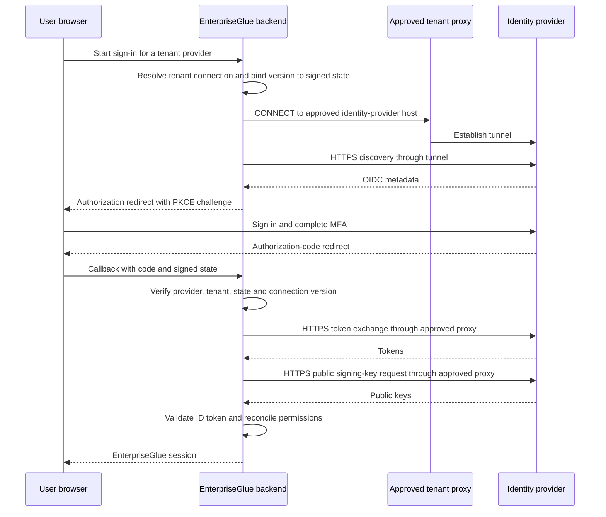

# Tenant SSO connection contract

This contract is for host developers and deployment operators. It describes the
SSO transport, administration API, persisted configuration and upgrade boundary.
The first version supports unauthenticated HTTP proxies carrying HTTPS via
CONNECT. It applies to direct OIDC providers, including Microsoft Entra ID.

## Routing and trust

A tenant selects `direct` or an operator-approved `proxyProfileKey`. A pooled
platform provider uses the separate `platform` scope. Single-tenant installations
use `platform` for all provider connections. Tenant IDs come from trusted request
context and provider ownership; request bodies cannot select a different tenant.

The connection covers discovery, authorization-code exchange, JWKS retrieval and
OIDC logout metadata/key checks. Browser redirects, local session refresh,
SCIM, LDAP, SAML certificate validation, engines, Git and other clients retain
separate transports. This feature does not change OIDC claims, MFA enforcement,
role mapping, token validation or EnterpriseGlue session duration.



Each operation receives its own Undici dispatcher in an AsyncLocalStorage lease.
The dispatcher is destroyed on completion. There is no global dispatcher or
environment mutation. Explicit Direct ignores ambient proxy settings; proxy
failure fails closed. No direct retry is allowed. Each scope has at most eight
concurrent transport operations and each dispatcher at most two connections.

A catalogue contains at most 32 profiles and 256 distinct assigned scopes.
Proxy DNS is bounded to five seconds. Every returned address is checked; the
connection uses a validated literal address to prevent a second DNS resolution.
Loopback, link-local, multicast, unspecified and metadata destinations are denied.
Private proxy addresses require operator approval with `allowPrivateProxy`.
Every backend provider request requires HTTPS, rejects redirects and checks the
profile's exact approved hostnames as well as the existing IdP endpoint policy.
The proxy operator must enforce equivalent destination restrictions at CONNECT,
including destination DNS; the application cannot inspect the proxy's resolver.

TLS verification is always enabled. An optional `caCertificateRef` resolves through
the existing env/file/Docker secret resolver and extends the Node default trust
only inside this connection. Certificate contents are never returned or exported.
An SSO-only deployment also needs an audit of existing global proxy/CA settings:
this feature cannot remove process-wide routing already used by other clients.

## API and permissions

| Operation | Platform path | Permission action |
| --- | --- | --- |
| Read selection and assigned profile names | `GET /api/identity/sso-connection` | `platform.sso.providers.read` |
| Test a draft | `POST /api/identity/sso-connection/test` | `platform.sso.providers.manage` |
| Activate selection | `PUT /api/identity/sso-connection` | `platform.sso.providers.manage` |
| Read or update approved catalogue | `GET` / `PUT /api/identity/sso-proxy-catalogue` | `platform.sso.providers.manage` |

Tenant connection paths use `/api/t/{tenantSlug}/identity/sso-connection` and
its `/test` suffix with the corresponding `tenant.sso.providers.read/manage`
actions. The existing `/t/{tenantSlug}/api/identity/…` compatibility aliases are
also supported. On verified tenant hostnames, root-shaped connection requests
pass through the existing hostname resolver before tenant authorization.
Catalogue administration is platform-only in pooled mode.
Tenant selectors receive only assigned profile keys, names and enabled state.
They do not receive proxy hostnames, assignments or trust references.

PUT requires the `expectedVersion` returned by GET. Updates use a database
compare-and-set fence; stale edits return a conflict. Draft tests use a stored,
scoped direct OIDC provider selected by `providerKey`; arbitrary test URLs are
not accepted. Tests check network connectivity, metadata and JWKS retrieval;
they do not exercise the client secret, MFA, user claims or engine permissions.
A real sign-in is a separate acceptance step. Failed tests do not activate a
connection. Diagnostic failures expose a safe stage, not upstream response data.

Proxy activation requires a matching successful test. Headless activation can
perform that test when `providerKey` is supplied. Required proxy assignments
reject Direct and legacy/unset routing. An active profile cannot be removed,
disabled, unassigned or have its endpoint, destination list or trust changed.
Create a replacement profile, test it and switch tenants before retiring the old
profile. This also provides an explicit certificate rotation workflow.

## Headless files

The existing bundle validate, preview/diff, apply, archive and export lifecycle
accepts `./sso-proxy-catalogue.json` and `./sso-connection.json`. Add the desired
file paths to the bundle's `imports`. Apply the catalogue from a platform-scoped
configuration; tenant bundles can select assigned profiles but cannot approve
endpoints. Apply creates providers before testing/activating a connection.

A catalogue file:

```json
{
  "ssoProxyCatalogue": {
    "ownershipMode": "config_locked",
    "profiles": [{
      "key": "corporate",
      "displayName": "Corporate SSO proxy",
      "host": "proxy.example.net",
      "port": 8090,
      "enabled": true,
      "scopeKeys": ["11111111-1111-4111-8111-111111111111"],
      "requiredScopeKeys": [],
      "allowedIdentityProviderHosts": ["login.microsoftonline.com"],
      "allowPrivateProxy": true
    }]
  }
}
```

Use `platform` instead of a tenant UUID for a single-tenant installation or
platform-wide providers. Set `requiredScopeKeys` only after the connection is
configured and tested: requiring a proxy immediately blocks other routing.
Add `caCertificateRef`, for example `file:///etc/enterpriseglue/secrets/sso-ca.pem`,
only when that reference is available through the configured secret provider.
Do not place PEM data, credentials, schemes or paths in the proxy hostname.

A tenant selection file:

```json
{
  "ssoConnection": {
    "connection": {"mode": "proxy", "proxyProfileKey": "corporate"},
    "providerKey": "entra",
    "ownershipMode": "config_locked"
  }
}
```

A deliberate Direct selection is `{"ssoConnection":{"connection":{"mode":"direct"}}}`.
Ownership defaults to `config_locked`; portal changes are rejected for locked
settings. `config_warn` permits portal edits and records drift. Only the owning
bundle can reapply its settings. Export includes desired configuration owned by
the requested bundle, with references, without runtime qualifications. Omitting
these files from a later bundle retains active SSO configuration; it does not
remove a required route or silently return to legacy routing.

## Persistence, upgrades and Cloud qualification

Migration `AddSsoConnections1700000000134` adds nullable JSON-text columns to
`platform_settings` and `tenant_login_policies`. Existing rows remain unset and
preserve legacy runtime routing. Tenant creation records explicit Direct. An
existing single-tenant installation can deliberately migrate with the UI or
headless selection above. No restart is required for connection configuration;
new operations resolve current state. A pending sign-in must restart after its
connection version changes. Existing EnterpriseGlue sessions retain their
existing session/refresh policies.

PostgreSQL pooled deployments use schema-epoch manifest v4, bounded through 0134.
The separately credentialed owner applies 0132, 0133 and 0134 in order, verifies
each stage and retains existing grants. No new table or runtime privilege is
introduced. Application startup and preflight remain verify-only; the new
runtime requires the migration to be applied before rollout. The migration's
DOWN refuses while either table holds scoped SSO configuration. Older schema-
epoch runtimes do not accept the 0134 ledger. Treat an application downgrade as
a coordinated reviewed operation; restoring an older image is insufficient.

In managed Cloud mode, successful tests record the scope, connection fingerprint,
release and shard identity. Qualifications cannot be imported or exported.
A new serving runtime rejects an unqualified proxy connection, including during
tenant release activation, until a draft test on that runtime succeeds.

Cloud release operations must include SSO routing capability, target-runtime
connectivity evidence and the 0134 database boundary in their existing
`ssoSession` and migration compatibility gates. Drain incompatible runtimes and
block fallback to them before enabling scoped proxies. This host change does
not provision private connectivity or change the control plane's release
compatibility policy. Local tests do not establish a Cloud release's admission,
network route, deployment or customer connectivity.

## Verification

The dedicated service, route, transport and UI tests cover tenant assignments,
required routes, ownership/drift, stale writes, signed-state changes, diagnostics
and activation. The transport test uses real local TLS and two CONNECT proxies,
signed OIDC responses, bad nonce rejection, scoped trust, DNS pinning and no
fallback. The configuration-bundle lifecycle test covers apply/export/omission.
The database matrix rehearses 0134 DOWN/UP/retry against clean-install metadata.
The disposable browser lane also activates a profile through the portal and
checks actual CONNECT traffic during OIDC sign-in and scoped engine authorization.
Run identity protocol browser rehearsals and the affected acceptance lanes
before delivery; a successful metadata test alone does not qualify sign-in.
